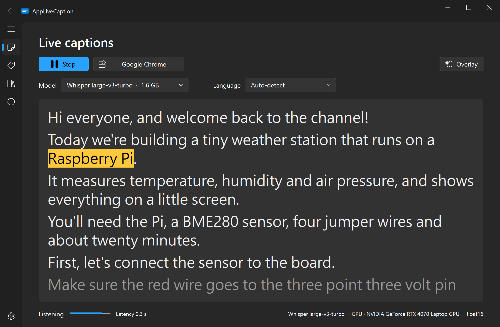
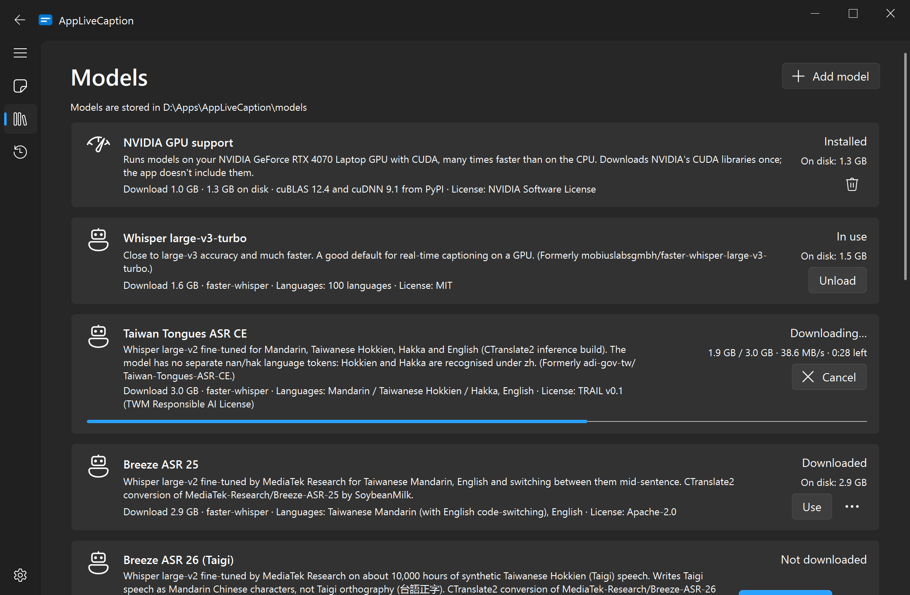
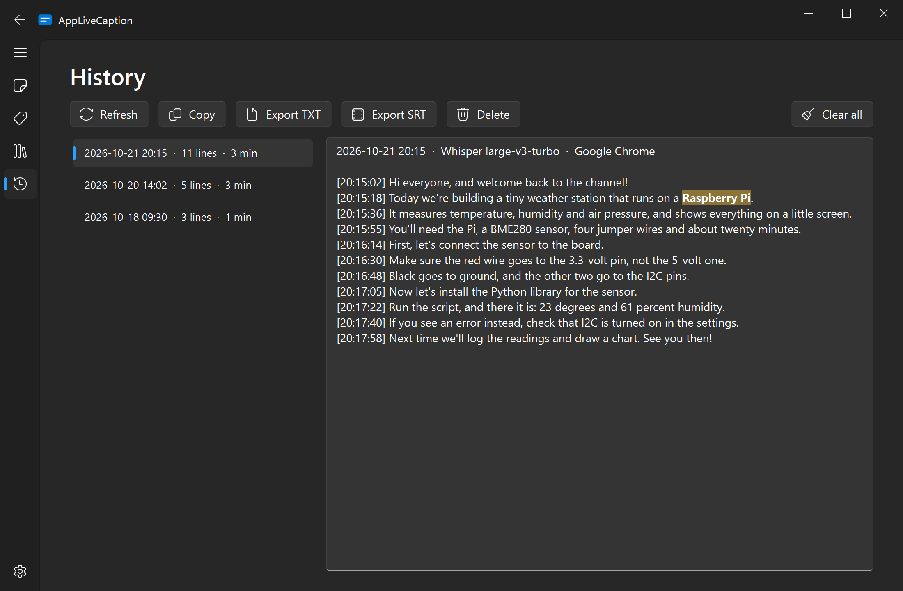

# AppLiveCaption


Live captions for Windows 10/11, made right on your own PC. Pick what to listen to (your microphone, everything playing, or just a few apps) and watch the words appear while people talk.
No cloud and no account: once a model is downloaded, it works without internet.



## Features

- 🎧 **Caption anything** – Your microphone, everything playing on the PC, or only the apps you tick (Chrome, Teams, VLC, …), mixed together.
- ⚡ **Live as people talk** – Captions update while someone speaks and settle into a final line when they pause.
- 🪟 **Floating overlay** – An always-on-top caption bar for videos, games and calls. Drag it anywhere, resize it, or let clicks pass through it.
- 🔒 **Private by design** – Speech is recognized on your PC and never uploaded.
- 🧠 **Pick your model** – Whisper from tiny to large-v3 and turbo, plus models made for Taiwan: Breeze ASR 25 (Mandarin + English), Breeze ASR 26 (Taigi) and Taiwan Tongues (Hokkien and Hakka).
- 🚀 **GPU boost** – Got an NVIDIA GPU? One click downloads GPU support and captions get many times faster. No GPU? It runs on the CPU too.
- 📜 **History** – Every session is saved. Copy it, or export it as TXT or SRT subtitles.

## Screenshots

The overlay floats on top of anything, here a night-market vlog in Mandarin:


| 🧠 Models and GPU support | 📜 History |
| --- | --- |
|  |  |

## Quick start

1. Download the zip from the [Releases](https://github.com/EnderDragonEP/AppLiveCaption/releases) page, unzip it anywhere you like (Documents, a USB stick, …) and run `AppLiveCaption.exe`. Python isn't needed.
2. Pick a model in the **Model** dropdown. If it isn't downloaded yet, the app shows its card on the **Models** page; download it there and the app switches to it when it's done.
3. Click the source button (it says *System audio* at first) and choose **Microphone**, **System audio** or **Apps**. In Apps mode, tick the apps to caption. They're remembered and picked up again whenever they start.
4. Choose **Auto-detect** or a language, then press **Start**. 🎉
5. Want captions on top of everything? Turn on **Overlay**. Drag it to move it and drag its edges to resize it. Click-through (the pin button, Settings or the tray menu) lets clicks pass to the window below; turn it off again from the tray icon.

The status line shows the latency and the device in use. You can switch models while captioning: the app pauses, loads the new one in the background and carries on.

## Which model should I use?

| You have | Try |
| --- | --- |
| An NVIDIA GPU (6 GB+) | Whisper large-v3-turbo (the default): partial captions in about 0.3 s on an RTX 4070 Laptop |
| Taiwanese Mandarin, or Mandarin mixed with English | Breeze ASR 25 (GPU) |
| Taiwanese Hokkien (Taigi) | Breeze ASR 26 (GPU) |
| Hakka | Taiwan Tongues ASR CE (GPU) |
| Only a CPU | Whisper base or small |

The app warns you when a model will probably be too slow for real time on your PC. If the GPU runs out of memory, the model moves to the CPU and the app suggests a smaller one. If recognition still can't keep up, the oldest audio is skipped so the captions don't fall further and further behind.

## GPU support

To use an NVIDIA GPU, the app needs NVIDIA's CUDA libraries. They're big (1.3 GB), so they aren't in the download. Instead, on a PC with an NVIDIA GPU, the **Models** page has an **NVIDIA GPU support** card: click **Download** once (about 1 GB) and a model that's already loaded moves to the GPU as soon as it finishes. The app also offers this at start-up while models run on the CPU.

- Only the NVIDIA display driver is needed; you don't have to install the CUDA Toolkit.
- The files come from NVIDIA's own packages on PyPI and are checked against SHA-256 hashes pinned in the source before anything is unpacked.
- The card's delete button removes them again. Windows locks DLLs that are in use, so they're deleted the next time the app starts.
- No internet on that PC? Copy the app folder (or just its `cuda` folder) from another PC.

<details markdown="1">
<summary>Technical details</summary>

faster-whisper (CTranslate2) needs cuBLAS 12 and cuDNN 9. The download ([app/asr/cuda_libs.py](https://github.com/EnderDragonEP/AppLiveCaption/blob/main/app/asr/cuda_libs.py)) fetches `nvidia-cublas-cu12` 12.4.5.8, `nvidia-cudnn-cu12` 9.1.0.70 and `nvidia-cuda-nvrtc-cu12` 12.4.127, resumes after an interruption, and keeps only the ten DLLs CTranslate2 loads. The versions match the cuDNN loader that CTranslate2 4.6 bundles (`cudnn64_9.dll`); cuDNN must not be older than that loader.

The app also uses the same libraries when they're already on the PC, in this order: the downloaded `cuda` folder, NVIDIA's pip packages (handy when running from source), PyTorch's `torch\lib`, or a CUDA 12.x Toolkit (`CUDA_PATH_V12_*`) ([app/asr/cuda_setup.py](https://github.com/EnderDragonEP/AppLiveCaption/blob/main/app/asr/cuda_setup.py)). Only a complete set counts; otherwise models run on the CPU. `python -m app.cli cuda --download` downloads GPU support from a terminal.

</details>

## Limitations

- Captioning individual apps needs Windows build 20348 or later (in practice Windows 11). On older builds that option is hidden; microphone and system audio still work.
- When several selected apps talk at the same time, they're transcribed as one stream, so the louder one usually wins.
- Large models need a GPU for real time. On the CPU, use Whisper base or small.
- Breeze ASR 26 writes Taigi as Mandarin Chinese characters, not Taigi orthography (台語正字).
- Translation, speaker identification and cloud speech services are out of scope.

## Where your stuff lives

Everything the app writes stays next to `AppLiveCaption.exe`. Moving the folder moves all of it, and deleting the folder removes all of it. Nothing goes to AppData.

| What | Where (next to the exe) |
| --- | --- |
| Settings | `config.json` |
| History | `history\` |
| Logs | `logs\app.log` (Settings → Advanced → Logs opens the folder) |
| Models | `models\` (Settings → Model folder can point somewhere else, e.g. a folder several copies share) |
| GPU support | `cuda\` |

If the app's folder can't be written to (for example under `C:\Program Files`), the app uses `%LOCALAPPDATA%\AppLiveCaption` instead. The `ALC_DATA_DIR` environment variable picks another folder (the tests use it).

## Offline and privacy

Audio never leaves your PC. The app goes online only when you ask it to:

- **Downloading a model** from Hugging Face (Models page).
- **Downloading GPU support** from PyPI (Models page).
- **Check for updates**, which asks the GitHub API for the latest release.

Everything else runs offline: the app sets `HF_HUB_OFFLINE=1` at start-up and loads models from their local folders only.

## Run from source

You need Python 3.11 or 3.12 (64-bit). The app uses your installed Python's packages; no virtual environment is needed.

```powershell
git clone https://github.com/EnderDragonEP/AppLiveCaption
cd AppLiveCaption
py -3.12 -m pip install -r requirements.txt
```

After that, double-click **`AppLiveCaption.pyw`** to run the app with no console window. If your Python is missing packages, a message box lists them with the exact `pip install` command. From a terminal:

```powershell
python -m app.main                 # or: pyw AppLiveCaption.pyw
python -m app.main --start         # start captioning as soon as the model has loaded
python -m app.main --minimized     # start minimized, e.g. when launched at sign-in
```

When run from source, the app keeps its settings, history, logs, models and GPU support in the project folder (git ignores them).

<details markdown="1">
<summary>About requirements.txt</summary>

`requirements.txt` is written to share a Python with other software:

- Packages only this app uses (PySide6, faster-whisper, onnxruntime, the audio libraries, …) are pinned to the tested versions.
- Packages that other software often shares (NumPy, huggingface_hub, CTranslate2, …) take a version range, so the versions you already have are kept whenever they work.
- PyTorch isn't needed. If it's installed for other projects, it's left alone (the app even keeps CTranslate2 from importing it).
- To see what pip would change before installing anything, run `py -3.12 -m pip install --dry-run -r requirements.txt`.
- Chinese conversion uses `opencc-python-reimplemented`, which gives the same results as the `OpenCC` package. Don't install both: they share the `opencc` folder and overwrite each other's files.

If you'd rather keep the app's packages separate, a virtual environment works too: create one, install `requirements.txt` into it, and run the app or `build.ps1 -Python .venv\Scripts\python.exe` with it.

</details>

### Console tools

Handy for testing capture and recognition without the GUI:

```powershell
python -m app.cli devices                                  # microphones and loopback devices
python -m app.cli apps                                     # apps that can be captured
python -m app.cli cuda [--download]                        # GPU support status / download it
python -m app.cli levels --mode system                     # input level per source
python -m app.cli levels --mode apps --apps chrome.exe,ms-teams.exe --mic --record mix.wav
python -m app.cli transcribe --mode system --model whisper-large-v3-turbo
python -m app.cli transcribe --model breeze-asr-25 --wav speech.wav   # simulated real time
```

## Build the exe

```powershell
.\build.ps1
```

The script uses your installed Python 3.12 or 3.11 (what `py -3.12` or `py -3.11` finds, otherwise `python` on PATH), checks the required packages, runs the unit tests and builds `dist\AppLiveCaption\AppLiveCaption.exe` with PyInstaller. The folder is about 210 MB (about 80 MB zipped), and a build takes 1–2 minutes. Models and GPU support aren't bundled; users download them from inside the app.

| Option | Effect |
| --- | --- |
| `-Python <path>` | Build with this `python.exe` instead of finding one. |
| `-Console` | Keep a console window in the built app, for debugging. |
| `-Clean` | Delete earlier build output and PyInstaller's cache first. |
| `-Install` | Run `pip install -r requirements.txt` for that Python before building. |
| `-SkipTests` | Skip the unit tests. |

If PowerShell refuses to run the script because of the execution policy, run `powershell -ExecutionPolicy Bypass -File .\build.ps1` instead. `Get-Help .\build.ps1 -Detailed` lists the options.

The build output is `AppLiveCaption.exe` and `_internal\`. Everything else in `dist\AppLiveCaption\` (the settings, history, models and GPU support of a built app you ran there, or your own files) survives a rebuild, even with `-Clean`. For a release, zip only `AppLiveCaption.exe` and `_internal\`, and tag it like `v1.0.1` so the update check finds it.

The app's name and version live in [app/\_\_init\_\_.py](https://github.com/EnderDragonEP/AppLiveCaption/blob/main/app/__init__.py) (`__version__`, currently 1.0.0). Settings → About shows them, and the build writes them into the exe's file properties (Properties → Details).

<details markdown="1">
<summary>What the build leaves out, and why</summary>

The build only bundles what the app needs, even when your Python has many other packages installed: the spec reads `requirements.txt`, follows the installed packages' dependencies and excludes everything else ([tools/build_excludes.py](https://github.com/EnderDragonEP/AppLiveCaption/blob/main/tools/build_excludes.py); run it to see the list). Without that, PyInstaller would follow optional imports into unrelated packages (CTranslate2 alone would pull in an installed PyTorch).

It also leaves out what the app never loads: NVIDIA's CUDA libraries (downloaded in the app instead), PyAV and FFmpeg (faster-whisper only needs them to read audio files; [tools/pyi_rth_no_av.py](https://github.com/EnderDragonEP/AppLiveCaption/blob/main/tools/pyi_rth_no_av.py) stands in for the import), Hugging Face's Xet client, Qt's software OpenGL renderer, Qt Quick/QML, Qt's own translations, unused image formats and plugins, and the optional SciPy/Pillow extras of the widget library.

PyInstaller replaces the whole output folder, so `build.ps1` moves everything that isn't build output to `dist\AppLiveCaption.kept\` during the build and back afterwards. Without the script, the equivalent build command is `pyinstaller AppLiveCaption.spec --noconfirm` (set `ALC_CONSOLE=1` for a console window), but then nothing is kept.

</details>

## Tests

```powershell
python -m unittest discover -s tests
```

`build.ps1` runs them before every build.

## Adding a model

All models are listed in [app/models/catalog.json](https://github.com/EnderDragonEP/AppLiveCaption/blob/main/app/models/catalog.json). Adding one only takes a new entry there (display name, Hugging Face repo, languages, approximate size, license). Every model runs on faster-whisper, so it must be in CTranslate2 format; a model published only in Hugging Face transformers format can be converted with CTranslate2's `ct2-transformers-converter --quantization float16`. Clicking a model's card on the Models page opens its page on Hugging Face.

| Model | Repository |
| --- | --- |
| Whisper large-v3-turbo | `dropbox-dash/faster-whisper-large-v3-turbo` |
| Taiwan Tongues ASR CE | `adi-gov-tw/Taiwan-Tongues-ASR-CE-v1.0` |
| Breeze ASR 25 | `SoybeanMilk/faster-whisper-Breeze-ASR-25` |
| Breeze ASR 26 (Taigi) | `SoybeanMilk/faster-whisper-Breeze-ASR-26` |
| Whisper tiny / base / small / medium | `Systran/faster-whisper-{size}` |
| Whisper large v1 / v2 / v3 | `Systran/faster-whisper-large-{v1,v2,v3}` |

<details markdown="1">
<summary>Notes on the models</summary>

- Two repositories were renamed on Hugging Face, and the catalog uses the current names: `mobiuslabsgmbh/faster-whisper-large-v3-turbo` → `dropbox-dash/faster-whisper-large-v3-turbo`, and `adi-gov-tw/Taiwan-Tongues-ASR-CE` → `adi-gov-tw/Taiwan-Tongues-ASR-CE-v1.0`.
- **Taiwan Tongues ASR CE:** its tokenizer and `config.json` contain only the 99 standard Whisper language tokens; there are no `nan` (Hokkien) or `hak` (Hakka) tokens. Hokkien and Hakka are recognized under `zh`, so the app offers *Auto-detect*, *Mandarin / Taiwanese Hokkien / Hakka* (`zh`) and *English*. Its license is the TRAIL v0.1 responsible-AI license.
- **Breeze ASR 25:** MediaTek Research publishes it only in transformers format (`MediaTek-Research/Breeze-ASR-25`), so the app uses SoybeanMilk's float16 CTranslate2 conversion. Its `model.bin` is byte-for-byte identical to a conversion made locally with `ct2-transformers-converter --quantization float16`, and on 27 test utterances it gave the same transcripts as the original on PyTorch for all Mandarin and English speech, in about half the decoding time.
- **Breeze ASR 26:** a fine-tune of Whisper large-v2 for Taiwanese Hokkien (Taigi). It writes Taigi speech as **Mandarin Chinese characters**, not Taigi orthography (台語正字). The app uses SoybeanMilk's CTranslate2 conversion of `MediaTek-Research/Breeze-ASR-26`; on 16 Common Voice Taigi clips it matched the original on PyTorch exactly (30.7% character error rate for both, against 39% for Breeze ASR 25 on the same clips). That repository has no `tokenizer.json`, so the catalog's `extra_files` takes it from `SoybeanMilk/faster-whisper-Breeze-ASR-25`, whose vocabulary is identical; without one, faster-whisper would fetch a tokenizer from the internet. Whisper's language detection doesn't recognize Taigi (in testing it guessed Lao, Georgian and others), so the catalog sets `"auto_detect": false`: the model always decodes as `zh`, and its language dropdown only offers *Taiwanese Hokkien (Taigi)*.

</details>

## Translating the UI

All UI text is English and goes through `tr()`. To add Traditional Chinese:

```powershell
pyside6-lupdate (Get-ChildItem app -Recurse -Filter *.py).FullName -ts app\i18n\app_zh_TW.ts
pyside6-linguist app\i18n\app_zh_TW.ts          # translate
pyside6-lrelease app\i18n\app_zh_TW.ts -qm app\i18n\app_zh_TW.qm
```

The app loads `app\i18n\app_<locale>.qm` for the Windows display language automatically, and the build bundles any `.qm` files it finds.

## How it works

```text
app/
  main.py              entry point (sets offline mode, theme, splash)
  paths.py             where the app keeps its data (next to the exe)
  config.py            settings (qfluentwidgets QConfig)
  cli.py               console tools
  audio/               capture (PyAudioWPatch, process loopback via comtypes),
                       app list (pycaw), resampling (soxr), mixer + limiter, Silero VAD
  asr/                 faster-whisper backend, streaming (partials/finals, LocalAgreement,
                       prompts), hallucination filter, OpenCC, GPU support
                       (cuda_libs.py downloads it, cuda_setup.py finds it)
  models/              catalog, downloader, local storage
  core/                controller (worker thread) and history
  ui/                  main window, pages, source flyout, overlay, tray
```

<details markdown="1">
<summary>The interesting parts</summary>

- **Per-app capture** uses the Windows process loopback API (`ActivateAudioInterfaceAsync` with `AUDIOCLIENT_ACTIVATION_TYPE_PROCESS_LOOPBACK` and `PROCESS_LOOPBACK_MODE_INCLUDE_TARGET_PROCESS_TREE`), implemented in pure Python with comtypes ([app/audio/process_loopback.py](https://github.com/EnderDragonEP/AppLiveCaption/blob/main/app/audio/process_loopback.py)). Each app is captured from its root process, so child renderer processes are included.
- **Mixing:** every source is converted to 16 kHz mono, then a wall-clock mixer sums them and a peak limiter prevents clipping. Silence is inserted for sources that deliver nothing (loopback endpoints send no data while nothing plays), so the end of an utterance is still detected.
- **Streaming:** Silero VAD (the ONNX model bundled with faster-whisper) gates the audio. The current utterance is re-transcribed every ~0.6 s for the partial caption; LocalAgreement fixes the start of the partial once two hypotheses agree. After 0.6 s of silence, or at 18 s, a final caption is decoded with beam search, and the next utterance starts, prompted with the previous final caption.
- **Hallucination filter:** drops stock phrases such as "Thank you for watching", 謝謝觀看 and 字幕由…提供, collapses repeated phrases, drops repeated lines, and retries without the prompt when Whisper echoes it.

</details>

## Disclaimer

This software is provided "as is", without warranty of any kind. Use it at your own risk; the author is not responsible for any damage or data loss resulting from its use.

Captions are generated automatically and can be incomplete or wrong. Don't rely on them where accuracy matters, such as medical, legal or safety-critical situations.

AppLiveCaption started as a personal project. It is not affiliated with or endorsed by Microsoft, OpenAI, MediaTek, Hugging Face or NVIDIA. The speech recognition models are made by their respective authors and used under their own licenses.

Claude Code was used in the development of this software.

## License

[GPL-3.0](LICENSE) © 2026 Ender Yang. Dependency information is in [THIRD_PARTY_NOTICES.md](THIRD_PARTY_NOTICES.md).
